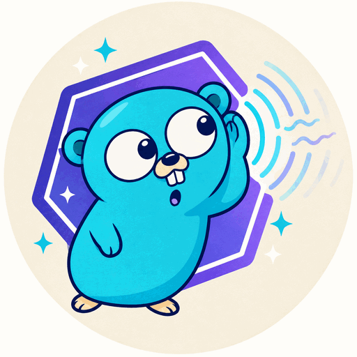

<div align="center">



# whisper.go

Transcribe speech from Go with [whisper.cpp](https://github.com/ggml-org/whisper.cpp), with no cgo.

[](https://github.com/mpyw/whisper.go/actions/workflows/test.yml)
[](https://codecov.io/gh/mpyw/whisper.go)
[](https://pkg.go.dev/github.com/mpyw/whisper.go)

</div>

whisper.go transcribes speech in Go. It runs [whisper.cpp](https://github.com/ggml-org/whisper.cpp) itself, so it reads the same models and writes the same text.
It needs no cgo and no Wasm runtime: `go build` is enough.

> [!WARNING]
> This is an experiment. The API may change.

> [!IMPORTANT]
> whisper.go takes **raw samples** only. It reads no audio files: decode them first, such as with ffmpeg.
>
> **Audio**
>
> | Input | Supported | Notes |
> | --- | --- | --- |
> | Samples as `[]float32` | Yes | In [-1, 1]. For 16-bit integers, divide by 32768. |
> | 16 kHz (`whisper.SampleRate`) | Only this | No resampling. Other rates give wrong text, not an error. |
> | Mono | Only this | No downmixing. Mix stereo to one channel first. |
> | WAV, MP3, FLAC and other files | No | `ffmpeg -i in.mp3 -ar 16000 -ac 1 -f f32le out.raw` writes the samples. |
>
> **Models**
>
> | Format | Supported | Notes |
> | --- | --- | --- |
> | whisper.cpp's ggml format (`ggml-*.bin`) | Yes | Download them from [Hugging Face](https://huggingface.co/ggerganov/whisper.cpp). |
> | Quantization f16, q8_0, q5_1, q5_0, q4_1, q4_0 | Yes, with SIMD | ggml's matrix products run in Go, with SIMD under `GOEXPERIMENT=simd`. |
> | Other ggml types | Yes, without SIMD | They run in the module, as whisper.cpp's own C code. |
> | OpenAI's `.pt`, Hugging Face's safetensors, GGUF | No | Convert them with whisper.cpp's `models/convert-*.py`. |

whisper.go is a library. For a command-line tool, use whisper.cpp's own `whisper-cli`: it reads audio files, and can use a GPU.

## Quick start

**1. Install.**

```sh
go get github.com/mpyw/whisper.go
```

**2. Get a model.** Any whisper.cpp model in ggml format works. See the [list on Hugging Face](https://huggingface.co/ggerganov/whisper.cpp).

```sh
curl -LO https://huggingface.co/ggerganov/whisper.cpp/resolve/main/ggml-base.en.bin
```

**3. Convert the audio.** whisper.go takes samples, not audio files, as whisper.cpp's library does. Make them 16 kHz, mono, 32-bit float:

```sh
ffmpeg -i speech.mp3 -ar 16000 -ac 1 -f f32le speech.raw
```

**4. Transcribe.**

```go
package main

import (
	"context"
	"encoding/binary"
	"fmt"
	"log"
	"math"
	"os"

	"github.com/mpyw/whisper.go"
)

func main() {
	model, err := os.ReadFile("ggml-base.en.bin")
	if err != nil {
		log.Fatal(err)
	}
	m, err := whisper.New(model, nil)
	if err != nil {
		log.Fatal(err)
	}
	defer m.Close()

	raw, err := os.ReadFile("speech.raw")
	if err != nil {
		log.Fatal(err)
	}
	pcm := make([]float32, len(raw)/4)
	for i := range pcm {
		pcm[i] = math.Float32frombits(binary.LittleEndian.Uint32(raw[4*i:]))
	}

	res, err := m.Transcribe(context.Background(), pcm, nil)
	if err != nil {
		log.Fatal(err)
	}
	for _, s := range res.Segments {
		fmt.Printf("[%v -> %v] %s\n", s.Start, s.End, s.Text)
	}
}
```

**5. Build with SIMD.** It is 4 to 6 times faster. See [Performance](#performance).

```sh
GOEXPERIMENT=simd go build .
```

## Examples

| Example | What it does |
| --- | --- |
| [`example/jfk`](example/jfk) | Transcribes a WAV file. `mise run transcribe` downloads the model, and runs it. |
| [`example/record`](example/record) | Records from the microphone until Enter, then transcribes it, in any language |

## API

Full documentation: [pkg.go.dev](https://pkg.go.dev/github.com/mpyw/whisper.go).

### `New(model []byte, opts *Options) (*Model, error)`

Loads a model in whisper.cpp's ggml format. `model` may be reused or freed after `New` returns.

| Option | Default | Meaning |
| --- | --- | --- |
| `Log io.Writer` | discard | Receives whisper.cpp's log. Read it when `New` fails. |

### `(*Model).Transcribe(ctx, pcm []float32, opts *TranscribeOptions) (*Result, error)`

Transcribes `pcm`. `opts` may be nil.

**Input**

| `pcm` | Behavior |
| --- | --- |
| Mono, 16 kHz (`whisper.SampleRate`), in [-1, 1] | Expected |
| Samples outside [-1, 1] | Clipped |
| `NaN` samples | Read as 0 |
| Empty | An empty `Result`, with no language |
| Under 1640 samples (about 100 ms) | No segments. No language, if it was to be detected. |
| Too long for the memory (about 9 hours with tiny models) | `ErrTooLong`. Split the audio. |

**Options**

| Option | Default | Meaning |
| --- | --- | --- |
| `Language string` | `""` | A code such as `"en"` or `"ja"`, or a lowercase name such as `"japanese"`. `""` or `"auto"` detects the language. Detection needs a multilingual model: an English-only model always transcribes English. |
| `Threads int` | `GOMAXPROCS` | Threads to use. 0, a negative number, or more than `GOMAXPROCS` means `GOMAXPROCS`. At most 32. Each thread takes 8 MiB. |

**Result**

| Field | Meaning |
| --- | --- |
| `Language string` | The language code, given or detected |
| `Segments []Segment` | The text, in order |
| `Segment.Start`, `Segment.End` | `time.Duration` from the start of `pcm`, in steps of 10 ms. Never past the end of `pcm`. |
| `Segment.Text` | The text of the segment |

Each call is independent: the text of one call does not affect the next.

**Cancellation:** canceling `ctx` stops the call soon, within one of ggml's operations, and `Transcribe` returns `ctx.Err()`.

### `(*Model).Close() error`

Frees the model and its memory. It waits for the call in progress. Calls that were waiting for the model return `ErrClosed`, and so do calls after it. Calling it again returns nil.

### Errors

| Error | When | The model after it |
| --- | --- | --- |
| `ErrTooLong` | The audio does not fit in memory | Usable |
| `ctx.Err()` | `ctx` was canceled | Usable |
| `whisper: unknown language "..."` | The language is not one whisper.cpp knows | Usable |
| `ErrClosed` | The model was closed | Closed |
| An error that wraps `ErrClosed` | whisper.cpp trapped (aborted) | Closed. See [Limitations](#limitations). |
| `whisper: cannot load the model` | `New` got bytes that are not a model, or a model cut short | None. See `Options.Log`. |
| `whisper: the model is larger than the module's memory` | The model is over 4 GiB | None |

### Concurrency

A `Model` may be used from any goroutine. Its calls to `Transcribe` run one at a time.
To transcribe in parallel, load the model once per goroutine.

## Performance

> [!TIP]
> Build with `GOEXPERIMENT=simd`. Then whisper.go uses NEON on arm64, and AVX2 and FMA on amd64, for ggml's heaviest work.
> Without it, or on other CPUs, the same code runs without SIMD, 4.3 to 5.9 times slower.
> `GOEXPERIMENT=simd` is experimental in Go 1.27, and its API may change.

Time to transcribe `testdata/jfk.wav` (11 s of speech) with whisper.cpp 1.9.5 and tiny.en, on an Apple M2 Pro:

| Model | Threads | whisper.go | With `GOEXPERIMENT=simd` | Native whisper.cpp, CPU only |
| --- | --- | --- | --- | --- |
| f16 | 1 | 9.6 s | 1.73 s | 0.96 s |
| f16 | 8 | 1.34 s | 0.29 s | 0.26 s |
| q8_0 | 1 | 8.6 s | 1.58 s | 0.63 s |
| q8_0 | 8 | 1.20 s | 0.28 s | 0.17 s |
| q5_1 | 1 | 9.0 s | 1.51 s | 1.24 s |
| q5_1 | 8 | 1.25 s | 0.26 s | 0.24 s |

Loading a model took 0.03 to 0.1 s.
whisper.go runs matrix products, softmax and quantization in Go with SIMD. The rest of ggml has no SIMD, since wasm2go has none. That is most of the gap to native whisper.cpp.

## Limitations

| Limit | Details |
| --- | --- |
| 64-bit Unix and Windows only | Each model reserves 4 GiB of address space up front, so its memory never moves while threads read it. On other platforms, `New` fails. |
| Models below about 2 GB | A model takes about twice its size in memory, and more for whisper.cpp's state: `New` copies it in, and whisper.cpp builds its tensors from the copy. The 32 MB tiny.en-q5_1 took 106 MB, and the 78 MB tiny.en 194 MB. An 11 s call with 8 threads added about 80 MB. All of it must fit in 4 GiB. |
| About 6 bytes of memory a sample | For the samples and their mel spectrogram, and 7 with large-v3. Longer audio returns `ErrTooLong`. |
| Memory only grows | A model keeps the memory its longest call took, until `Close`. |
| A trap closes the model | whisper.cpp's aborts and errors trap. The error wraps `ErrClosed`, and so does every call after. The memory is freed once the model's threads end. A thread that waits for good keeps it. |
| A trap on a worker thread ends the program | The thread that waits for it would wait forever. |
| CPU only | whisper.cpp runs on its CPU backend. There is no GPU support. |
| Threads spin | ggml's threads spin while they wait for each other. On a busy CPU, more threads can be slower. |

## How it works

1. [whisper.go-wasm](https://github.com/mpyw/whisper.go-wasm) compiles whisper.cpp to WebAssembly (wasm32-wasip1-threads), with a few patches.
2. [wasm2go](https://github.com/ncruces/wasm2go) translates the WebAssembly to Go source. whisper.go-wasm publishes it as a Go module.
3. whisper.go runs that code. It provides the memory, the threads and the system calls, and runs ggml's heaviest work in Go.

## License

whisper.go is under the [MIT License](LICENSE).
A program built with it contains whisper.cpp and other software, through whisper.go-wasm.
Their licenses are in `whisperwasm.Licenses`, and in [whisper.go-wasm's licenses/](https://github.com/mpyw/whisper.go-wasm/tree/main/licenses).
Whoever distributes such a program must pass them on.

`testdata/jfk.wav` comes from whisper.cpp's samples, under its MIT License.

The mascot is the Go gopher, designed by Renée French, under [CC BY 4.0](https://creativecommons.org/licenses/by/4.0/).
